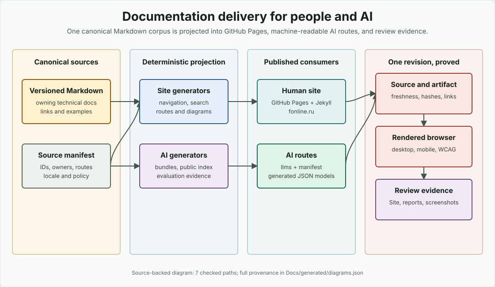

# Documentation Site Publication

This guide owns local preparation, rendering, review, and the prerequisites for separately authorized publication. Repository Markdown is canonical; do not create a second authored site tree.

## Source paths inspected

- `Docs/documentation-manifest.json`
- `Docs/Site/_config.yml`
- `Docs/Site/Layouts/default.html`
- `Docs/Site/Assets/css/docs.css`
- `Docs/Site/Assets/js/docs.js`
- `BuildTools/documentation_metadata.py`
- `BuildTools/docs_prepare.py`
- `BuildTools/docs_site_build.py`
- `BuildTools/docs_site.py`
- `BuildTools/docs_site_artifact.py`
- `BuildTools/docs-browser/audit.mjs`
- `BuildTools/docs-browser/package.json`
- `BuildTools/DocumentationDiagrams.json`
- `BuildTools/DocumentationScreenshots.json`
- `.github/disabled-workflows/validate.yml`

## Production contract

This checkout is the `qwear0/fonline` fork. Its workflow definitions are archived under `.github/disabled-workflows/`; they do not provide active CI, pull-request artifacts, or automatic deployment. Moving files locally does not change remote repository settings. Publication source settings and DNS ownership for the fork are not verified: the manifest records pending source verification and unobserved DNS state. `fonline.ru` is inherited URL/domain configuration, not a claim that this fork controls or deployed that site. A generated `CNAME` is configuration, not ownership evidence.

The archived upstream workflow describes a `documentation-site` artifact and a dependent master-only `documentation-publish` job gated on `cvet/fonline`. That is historical design, not an enabled publication route for this fork. Do not reactivate it, upload artifacts, change Pages settings, or alter DNS without separate owner authorization.

| Concern | Owner or local contract |
|---|---|
| Canonical content | Versioned Markdown and reviewed EN/RU translations |
| Renderer | GitHub Pages-compatible Jekyll |
| URL, repository, domain, pins | `publishing` in `Docs/documentation-manifest.json` |
| Site configuration | `Docs/Site/_config.yml` |
| Rendering shell | `Docs/Site/Layouts/default.html`, local CSS/JavaScript/assets |
| Navigation/search/routes | `BuildTools/docs_site.py` from manifest stable IDs |
| Teaching diagrams | `DocumentationDiagrams.json`, generated local desktop/mobile SVG, provenance catalog |
| Tool screenshots | `DocumentationScreenshots.json`, reviewed PNG captures and provenance catalog |
| Review output | Local `Workspace/DocumentationSite/` and reports bound to the exact reviewed state |
| Live publication | Administrator-owned, separately authorized and verified |

## Website source ownership

`Docs/Site/Layouts/` owns the HTML shell, `Data/` generated navigation, and `Assets/` styles, JavaScript, branding, and locale search. Layout/data sources are excluded from publication; asset URLs retain `/Docs/Site/Assets/`. Managed `bin`/`obj` trees at every depth, private/internal documentation, dependency trees, and local builds must remain excluded. `docs_site_artifact.py` rejects leaked internal pages/models and missing public assets.

`docs_prepare.py` writes ignored delivery inputs in dependency order; it does not regenerate versioned public models, Markdown, SVG, or PNG. It derives `Gemfile`, `.ruby-version`, and `CNAME` under `Workspace/Documentation/` from manifest pins/domain. Bundler configuration and `Gemfile.lock` also belong there. Root logical endpoints `llms.txt`, `llms-full.txt`, and `docs-manifest.json` live locally in that directory. `docs_site_build.py` prepares inputs, renders `Workspace/DocumentationSite/`, and copies endpoints plus `CNAME` to the rendered root. Public URL paths are unchanged by local output placement.

The layout includes root `VERSION` through Jekyll's standard include with `includes_dir: .`. Publish `/VERSION` byte-for-byte alongside `/docs-manifest.json` only in an authorized completed delivery. Do not copy version literals into the layout or route model. The rolling documentation channel is `current`/`master`, not a stable release; tagged `/versions/{version}/` snapshots remain deferred until supported immutable tags and policy exist.

<figure class="docs-diagram">
<picture>
<source media="(max-width: 700px)" srcset="../../../assets/diagrams/documentation-delivery-mobile.svg">

</picture>
<figcaption>Human and AI routes are projections of one versioned Markdown corpus. Local site, machine-readable endpoints, and review evidence must use the same manifest, generated artifacts, source revision, and content hashes.</figcaption>
</figure>

Public README entrypoints pin manifest-owned `.html` permalinks so `jekyll-readme-index` cannot silently replace them with directory indexes. Ordinary `index.md` pages use directory URLs with `/path/index.html` artifacts. Durable legacy Markdown pointers preserve old routes/anchors. Only one non-`replace` record may own a canonical target; stable IDs, not translated titles, join locales. See [Translation](translation.md) and [Documentation Maintenance](index.md).

## Reader navigation and static search

The repository-owned layout provides desktop sidebar, mobile drawer, table of contents, source links, code copy, theme choice, Engine version, and EN/RU switch. It owns no technical prose. Every public/current/human top-level page appears once in navigation; generated detail pages stay searchable behind their index. Internal plans and placeholders are excluded.

`Docs/Site/Data/docs-site.json` contains identity, localized navigation, routes, and locale pairs. `Docs/Site/Assets/docs-search.json` and `docs-search.ru.json` contain only their own locale's current public human pages. `docs-manifest.json#/routing` contains current/planned routes, locale availability, canonical ownership, and redirects. Localization owns `#/translation_status` in the same shared index; writers preserve other sections.

Search uses local JavaScript/browser APIs, with no hosted search service or remote script dependency. Titles/headings outweigh body text; full technical identifiers and camel-case components remain searchable. Pure numeric components and terms present in more than 60% of a locale corpus are omitted as non-discriminating. Summaries are at most 224 characters including ellipsis, cut at a word boundary. UTF-8 compact indexes each have a hard 1,867,776-byte budget; overflow fails rather than dropping documents. Hidden translation comments and empty anchors are ignored outside code, while visible text and literal markup examples remain indexed.

## AI and machine-readable routes

The inherited logical routes include `/llms.txt`, `/llms-full.txt`, `/docs-manifest.json`, its routing/translation sections, and generated model/evaluation/snippet/diagram/screenshot JSON below `/Docs/generated/`. Local generation does not establish that those endpoints are live. AI delivery records stable IDs, owners, lifecycle, canonical/source/raw URLs, provenance, normalized LF hashes, and bytes. Source links use the manifest repository/ref; the full-context bundle contains authored pages and generated indexes rather than duplicating huge API tables. Context-budget failure requires owner review, never truncation. GitHub Pages/Jekyll cannot create same-domain raw Markdown aliases without an additional publishing mechanism; do not promise those aliases.

Regenerate affected versioned models/references first, then diagrams/screenshots, snippets, localization, site/search/routes, AI evaluation, and AI delivery last. The final public manifest hashes the final inputs. See [Snippet Validation](snippets.md) and [AI Evaluation](ai-evaluation.md).

## Verified public state

Historical upstream evidence is not current fork evidence. The inherited report records public checks on 2026-07-10, 2026-07-15, and 2026-08-01, and an authenticated `cvet/fonline` Pages observation on 2026-08-02: legacy branch `master` at `/`, `fonline.ru`, HTTPS enabled, root/legacy routes responding, and then-unpublished EN/RU routes returning 404. It records successful upstream build `fee50fb636b5bd1e30509aded929df1fc0e95db5`, GitHub Pages IPv4 DNS, and no observed `_github-pages-challenge-cvet.fonline.ru` TXT. A later inherited 2026-10-09 note records selection of Actions source, with the first new-workflow deployment still unverified. These are dated observations of another repository, not live assertions or instructions to change remote state.

Refresh the fork's manifest source/DNS state only from authorized authenticated settings/API evidence and public DNS. A rendered page or generated `CNAME` cannot prove domain ownership. Credentials, registrar accounts, recovery codes, and private operational identities never belong in public evidence.

## Compatible environment

The manifest pins Ruby `3.3.4` and `github-pages` `232`; the ignored Gemfile lock does not replace that compatibility boundary. Windows Ruby needs Devkit/MSYS2 for native gems. Browser tooling pins Node `24.16.0`, Playwright `1.62.0`/Chromium `151.0.7922.34`, and axe-core `4.12.1` through the manifest and npm lock. Provision dependencies separately with authorization; a documentation repair does not authorize installation. Pin changes require lock reconciliation and the complete affected render/browser checks, never `latest` or lowered thresholds.

## Local build and preview

From the Engine root, with all dependencies already available and output paths authorized:

```bash
python BuildTools/docs_prepare.py --external
python BuildTools/docs_site_build.py
python BuildTools/docs_site_artifact.py --site-dir Workspace/DocumentationSite
npm --prefix BuildTools/docs-browser run audit
```

Preparation can fail after partial writes; do not treat subsequent artifacts as a completed build. Require a Jekyll/Liquid-error-free build with strict front matter. The browser audit serves only the completed local tree on an ephemeral loopback port, writes JSON/screenshots under `Workspace/`, and neither contacts production nor executes snippets. For interactive inspection:

```bash
python -m http.server 4000 --bind 127.0.0.1 --directory Workspace/DocumentationSite
```

Stop the server before switching revisions or dependency pins.

## Pull-request artifact

No automatic pull-request artifact is promised in this fork. Retain a local review artifact, static report, browser report, and screenshots with the exact source revision plus dirty-input identity, dependency pins, commands, and exits. All checks must consume the same completed tree.

The static gate requires every current/available-locale route, byte-identical static endpoints, correct canonical URL and HTML language, one `h1`, skip/main landmarks, accessible image/button names, unique IDs, search targets, and valid publishable local links.

The browser gate checks every route at desktop 1440 x 1000, mobile 390 x 844, and `zoom-200` 640 x 512 CSS pixels with device scale factor 2 (1280 x 1024 physical). The last profile models 200-percent reflow without a mobile user agent. Require no selected WCAG 2.2 A/AA axe violations, page/console/request failures, undecoded images, clipped reading columns, fixed-header/sidebar overlap, or reachable page overflow. Code blocks retain their own horizontal scrolling; long prose wraps. Instant-scroll probes prevent smooth scrolling from concealing overflow.

Interactions cover skip navigation, English/Russian search, dialog Escape, theme persistence, copy feedback, compact drawer focus containment/restoration, `html lang`, explicit README pairs, exact locale switching, architecture/gallery media, and Russian 200-percent reflow. Image decoding must finish before measurement/capture. Route profiles use separate browser contexts; preserve profile order and run interactions after all routes finish. Review every retained screenshot, including `zoom-200-russian-documentation.png`, and inspect changed pages interactively.

Axe incomplete nodes remain explicit, bounded rule/route records. For clipped scroll-container `color-contrast` cases, the existing audit resolves effective alpha-composited colors, uses WCAG relative luminance, and requires 4.5:1 or 3:1 for large text. Failed or unresolvable fallback fails; never relabel incomplete results as passes. Automated checks do not prove screen-reader behavior, cognitive clarity, every browser/font/magnifier, or production equivalence. Release review also needs keyboard-only, representative assistive-technology, and landed-environment 200-percent zoom observations.

## Production verification

Only after separately authorized publication, confirm the administrator-selected source and deployed commit, retain matching local reports/artifacts, inspect root/EN/RU/legacy routes, navigation, language switch, locale search, HTTPS, exact `CNAME`, and DNS. Escalate discrepancies to repository/domain administrators; do not commit generated HTML, invent another deployment workflow, weaken HTTPS, or claim the fork owns the inherited domain.

## Validation checklist

Require fresh affected model/reference, diagram/screenshot, snippet, localization, site, AI-evaluation/delivery checks and `docs_validate.py`; no removed unit suite is a prerequisite. Separately require the completed Jekyll build, static artifact check, pinned browser audit, visual/keyboard/assistive review appropriate to claimed acceptance, and exact retained target identity. Record missing dependencies and failed commands honestly. Local validation never authorizes or proves publication.
